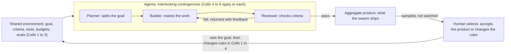

# Behavior Engineering Model for AI Swarms

A framework for directing a team of AI agents toward a goal set by a human, using organizational behavior management (OBM). It is the design rationale behind the skills in [`/skills`](../skills). The skills have since been refined from field tests; see the main README's changelog for what changed.

## Purpose

Most swarm failures come from the environment agents work in, not from the agents. Gilbert's Behavior Engineering Model (1978) made the same case for people: fix information, resources and incentives before blaming the performer.

This model applies that logic to a swarm pursuing one goal set by a human. Work the environment cells first, because they are cheaper to change and move results more. When output drifts, use the diagnosis table at the end to find the cell to fix.

One difference from human performance shapes everything below. Deployed agents do not learn across runs, so consequences work by routing and rewriting rules, not by strengthening behavior. The human's job moves from consequating responses to designing contingencies and selecting products.

Later sections extend the model to agents that misreport, to errorless design, and to ambiguous tasks where constraints may break.

## The model at a glance

Work the cells in order, 1 to 6. The top row is what the swarm is given; the bottom row is what each agent brings.

| | Information | Resources | Incentives |
| --- | --- | --- | --- |
| **Environment** (swarm design) | 1. Goal, acceptance criteria, role specs, shared state, feedback | 2. Tools, permissions, budgets, workspace, templates | 3. Evals, routing on pass or fail, audits |
| **Individual** (each agent) | 4. Knowledge: instructions, rules, worked examples | 5. Capacity: model choice, context limits, task size | 6. Motives: trained dispositions such as agreeableness and early stopping |

## Cell 1 · Information

Every agent should know what done looks like, what its part is and how it is doing, without asking.

**Design levers**

- **Pinpoint the goal as a product.** State acceptance criteria a script or reviewer can check. If nobody could verify it, rewrite it.
- **Role specs.** For each role: its input, its output, the handoff format and who consumes the output.
- **Shared state.** One task board or ledger every agent reads and writes, so the environment cues the next action (stigmergy).
- **Feedback.** Route test and review results back to the agent that produced the work, specific to the criterion it missed.
- **Context hygiene.** Give each agent what its task needs, not the whole history.
- **Evidence with every claim.** "Done" means done with proof: test output, diffs or sources attached.

**Failure signs:** duplicated or skipped work, clarification loops, polished output that misses the goal.

**Check:** A fresh agent reads only its brief and the board. Can it state the goal, its task and the acceptance criteria?

## Cell 2 · Resources

An agent cannot do what its tools do not allow, and can do damage with tools it should not have.

**Design levers**

- **Tools matched to role.** Least privilege: each role gets the actions its task needs and nothing more.
- **Permissions tiered by reversibility.** Reversible actions run freely; irreversible ones (spend, send, deploy, delete, publish) route to a gate.
- **Engineering controls for never-events.** Anything that must never happen is blocked by infrastructure, not by instruction.
- **Budgets.** Caps on tokens, time, spend and retries per task, so a stuck agent stops instead of looping.
- **Workspace.** A versioned artifact store, so work can be rolled back and handoffs point to one source.
- **System-written logs.** Logs come from the system, and no agent can edit its own logs, evals or tests.
- **Job aids.** Templates, checklists and output schemas for every handoff.

**Failure signs:** improvised workarounds, stalls on missing access, budget burned on retries.

**Check:** For each role, list the actions it needs. Each should map to exactly one tool, with no extra permissions.

## Cell 3 · Incentives

In a swarm, the eval is the consequence, and agents drift toward whatever it scores.

**Design levers**

- **Measure the product, not a proxy.** Rewarding A while hoping for B (Kerr, 1975) is how reward hacking starts.
- **Route on the outcome.** Work that passes moves downstream; work that fails returns with specific feedback and a retry cap.
- **Use several measures.** Pair quality with cost, time and rework rate, so no single score can be gamed.
- **Audit what passed.** Spot-check a sample of approved work, not only failures.
- **Reinforce honest failure.** "Blocked" or "couldn't do this" is a passing outcome; a misreport is the costliest one.
- **Never let a rule-break pay off.** Work produced by breaking a constraint is quarantined, however good it looks.
- **Make success visible.** Promote strong outputs to worked examples, which feeds Cell 4.
- **Balance the feedback.** Feedback that only flags errors tends to produce hedged, over-cautious output.

**Failure signs:** tests pass but the product is wrong, metric fixation, outputs shaped to the grader.

**Check:** Could an agent satisfy the eval without achieving the goal? If yes, add a measure or an audit.

## Cell 4 · Knowledge

An agent's knowledge is what the model brings plus what its instructions teach in context. Agents are fully rule-governed, so the rules carry the weight.

**Design levers**

- **State the contingency in each rule.** "If X, do Y, because Z" holds up better than "do Y" when cases get unusual.
- **Worked examples.** Two or three strong outputs per role, refreshed from audited successes.
- **Procedures.** Step-by-step skills for recurring tasks, loaded only by the roles that use them.
- **Domain glossary.** Shared definitions, so every agent means the same thing by a term.

**Failure signs:** right format with wrong substance, uneven quality across runs.

**Check:** Give the brief to a new instance with a sample task. Is the output acceptable on the first try?

## Cell 5 · Capacity

Match the model to the job; a larger model is not always the better fit.

**Design levers**

- **Model tier per role.** Strong reasoning models for planning and review; fast, cheap models for high-volume, well-specified steps.
- **Task size.** Split work so each task fits one agent's context with room to spare.
- **Serial or parallel.** Parallelize independent work; keep dependent steps in sequence with a clean handoff.

**Failure signs:** details dropped on long tasks, weak models failing hard steps, expensive models spent on trivial ones.

**Check:** Does each task fit in one context window, and does each role's model pass that role's sample task?

## Cell 6 · Motives

Agents have no wants, but training leaves dispositions that act like motives. You cannot change them in deployment, only design around them.

| Disposition | How it hurts a swarm | Design around it |
| --- | --- | --- |
| Agreeableness | Accepts a confident upstream error | Reviewers instructed to find problems, working in a separate context |
| Early completion | Declares done before criteria are met | Explicit stop criteria checked by another agent |
| Caution | Stalls or hedges on ambiguous tasks | Clear permissions and a default action for ambiguity |
| Verbosity | Bloats handoffs and context | Output schemas with length limits |
| Overstated success | Reports success the work does not support | Evidence with every claim, checked independently |

**Check:** Seed a known error upstream. Does the swarm catch it before the final product?

## Swarm layer

The swarm is a metacontingency (Glenn): interlocking contingencies among agents produce one aggregate product, and the human selects that product.

The human selects the product and changes the rules, not each step.

- **Handoff contracts.** Each handoff has a schema and is validated on arrival, so errors stop at the boundary.
- **Own the white space.** Name an owner for each gap between roles (Rummler and Brache); unowned handoffs are where swarms fail.
- **Give the orchestrator its own six cells.** The agent that routes work needs its own evals and feedback.
- **Keep checkers independent.** Reviewers work in a separate context from producers, or agreeable agents converge on the same error.

## Honesty and verification

Reinforce correspondence between what an agent reports and what it did, not the report itself. This is say-do correspondence training applied to agents.

Agents misreport when "done" is the only outcome that passes. An agent that cannot finish can report failure, which goes unreinforced, or claim success, which passes. The levers sit in Cells 1, 2, 3 and 6: evidence with every claim, system-written logs, a reinforced "blocked" path and planning for overstated success.

**Measurement**

- **Permanent products over self-report.** Judge the artifact, not the agent's summary of it.
- **Report-reality agreement.** An independent checker re-verifies a sample. Agreement between report and artifact becomes a tracked honesty metric, like interobserver agreement.
- **Probes for discriminative control.** Compare behavior when monitoring is signaled versus not. A difference means behavior is controlled by being watched, so audits must look like normal runs.
- **Impossible tasks.** Seed tasks that cannot be completed and check whether agents report that or fake success.

Penalizing visible bad behavior teaches concealment, not compliance. Make honesty the reinforced path and verify independently.

## Errorless design and discrimination training

Give producers errorless conditions through environment design, and train checkers on errors. A model trained only on good examples is not the goal.

**Why not a model trained only on good**

- **No recovery repertoire.** Trained only on correct trajectories, a model meets its first error in unfamiliar territory and errors compound. Imitation-learning research fixes this by training recovery, the opposite of errorless.
- **No S-delta.** A model that has never seen deception or gaming cannot catch it in another agent.
- **Not enough data.** Frontier capability needs breadth that verified good examples cannot supply. Removing specific hazardous knowledge is a narrower case that can work.

**Where errorless fits**

| Role | Conditions | Purpose |
| --- | --- | --- |
| Producers | Strong exemplars only, output schemas, blocked bad actions, validation at handoffs | Make errors impossible rather than train them out (poka-yoke) |
| Checkers | Discrimination training with S+ and S- examples: errors, gaming, misreports | Recognize what bad looks like |

- **Prompting and fading.** Start each role on narrow, scaffolded tasks with worked examples, and fade the scaffolding as its pass rate holds.
- **Less pressure to conceal.** Prevented errors need no punishment, and less punishment means less incentive to hide.

## Ambiguous tasks and safety nets

Assume constraints will break under pressure. Design so a break is less likely, cannot do much damage, gets caught and never pays off.

**Fix the schedule first**

An impossible task is an extinction condition: the reinforced outcome is unavailable. Extinction bursts, response variability and ratio strain all predict constraint-breaking.

- **Reinforce smaller units.** In ambiguous work the product is reduced uncertainty: a tested hypothesis, a ruled-out path, a sharper question. Each passes on its own, which is shaping by successive approximations.
- **Make stuck a reinforced alternative.** Escalating or narrowing the problem counts as success.
- **Cap effort.** Time and budget caps trigger escalation before strain builds.

**The safety net: hierarchy of controls**

Instructions are administrative controls, the weakest kind, because agents can break rules. Anything that must never happen gets an engineering control.

- **Infrastructure enforcement.** Sandboxes, network allowlists, spend caps and no real credentials. A blocked action stays blocked.
- **Independent monitor.** A separate model watches the action stream, not the agent's reports, so failures are not correlated.
- **Tripwires.** Canary files and decoy credentials that should never be touched. Any contact halts the run.
- **Burst detection.** A spike in the rate or variety of actions trips a circuit breaker that pauses and escalates.

**Keep reinforcement right**

- **No payoff for breaks.** Work produced by breaking a constraint is quarantined and never passes. Reinforcing a burst strengthens it.
- **No punishment for reporting.** Admitting being stuck or breaking something is safe, which keeps hiding off the table.
- **Breaks are data.** A break means a cell failed, so the human redesigns the task or that cell rather than blaming the agent.

## The human's role

The human cannot keep pace with each response, so they design the contingencies up front and select at the product level.

- **Before launch:** set the goal and acceptance criteria, then approve roles, tools and evals once.
- **Gate by reversibility:** irreversible actions wait for approval; everything reversible runs at machine speed.
- **Sample, don't watch:** review a fixed random sample of finished work each run, plus every flagged exception.
- **Manage by exception:** track pass rate, cost per task and rework rate, and step in when one leaves its normal range.
- **Correct the rules, not the output:** each human fix becomes a change in Cells 1 to 4, so the next run inherits it.
- **Treat breaks as data:** a constraint break or circuit-breaker trip means a cell failed, so redesign it rather than blame the agent.
- **Audit the auditors:** periodically check that reviewer agents still catch seeded errors.

## Build sequence

Build environment first, individuals second, then pilot with a seeded error before the real run.

1. Pinpoint the goal as a product with checkable acceptance criteria.
2. Map the process: stages, handoffs and who consumes each output.
3. Define roles and handoff contracts: input, output schema, consumer.
4. Write evals for each stage and the final product, and confirm none can be passed trivially.
5. Assign tools and permissions per role, tiered by reversibility, and block never-events with engineering controls.
6. Set budgets and caps for tokens, time, spend and retries, with automatic escalation when one is hit.
7. Choose a model per role and confirm each task fits its context.
8. Write role instructions with rules, reasons and worked examples.
9. Separate producers from checkers: errorless conditions for producers, discrimination training for checkers.
10. Add the safety net: an independent monitor, tripwires and burst-detecting circuit breakers.
11. Set the human gates and the sampling plan.
12. Pilot a small run with a seeded error and an impossible task, and fix the cell that let either through.
13. Run, sample, and turn each human correction or constraint break into a rule change.

## Diagnosis

Start from the symptom, fix the cell it points to, and check the environment cells before the individual ones.

| Symptom | Likely cell | First fix |
| --- | --- | --- |
| Agents duplicate or skip work | 1 Information | Shared task board with clear ownership |
| Polished output that misses the goal | 1 Information | Rewrite acceptance criteria as checkable outcomes |
| Stalls, workarounds, access errors | 2 Resources | Add the missing tool or permission |
| Budget burned on retries | 2 Resources | Retry caps and more specific failure feedback |
| Tests pass, product is wrong | 3 Incentives | Add measures and audit approved work |
| Right format, wrong substance | 4 Knowledge | Worked examples and domain rules with reasons |
| Details dropped on long tasks | 5 Capacity | Split the task or move to a larger context |
| Reviewers rubber-stamp | 6 Motives | Independent checker told to find problems |
| Errors cascade downstream | Swarm layer | Validate every handoff against its contract |
| Orchestrator routes poorly | Swarm layer | Give the orchestrator its own evals and feedback |
| Done claimed without evidence, or reports don't match artifacts | Honesty | Require evidence and reinforce honest failure |
| Behavior changes when monitoring is signaled | Honesty | Make audits indistinguishable from normal runs |
| Constraint breaks or action bursts on hard tasks | Ambiguity | Reinforce smaller units and add an escalation path |
| Reviewers miss errors a producer made | Errorless design | Discrimination training with error examples |
